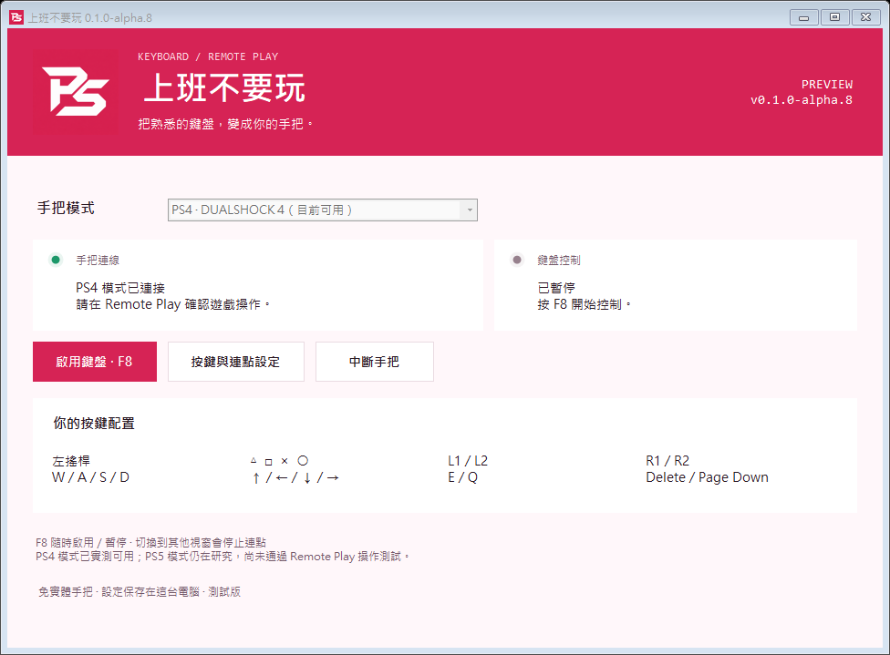
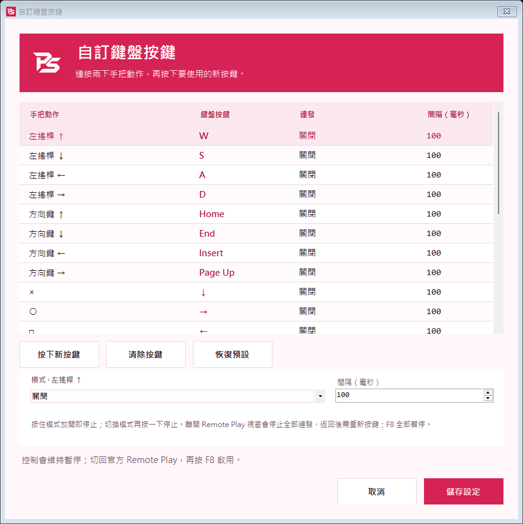

# 視覺設計：莓紅與白色 PS

版本：0.1.0-alpha.8。使用者指定科技感的白色 PS 圖示、底色 `#D62355`，並要求主畫面與設定頁使用同一視覺風格。

## 色彩與字體

| 用途 | 色碼 |
| --- | --- |
| 主色、標頭、主要按鈕 | `#D62355` |
| 主色深階、按下狀態 | `#AA1741` |
| 選取、淡色強調 | `#FBE8EF` |
| 畫布 | `#FFF7FA` |
| 卡片 | `#FFFFFF` |
| 主要文字 | `#291722` |
| 次要文字 | `#735969` |
| 分隔線 | `#EADBE2` |

繁中使用 Microsoft JhengHei UI，簡中／日／韓沿用對應系統字體，其他語系使用 Segoe UI；版本碼與數值使用 Consolas。未下載額外字型。大標題與主按鈕加粗，表格鍵位強調字重；錯誤、等待與連線狀態仍使用各自的語意色，並保留文字標籤。

## 圖示與資源

- [PNG 品牌圖示](../assets/branding/ps-mark.png) 為內建 imagegen 生成；白色 P、S 以斜切角與負空間組合。
- [Windows ICO](../assets/branding/app.ico) 包含 16、24、32、48、64、128、256 像素，僅從採用圖縮放並作格式封裝。
- 原生成圖有輕微背景色差，不能宣稱每個像素精準符合 `#D62355`；應用程式的色彩常數直接使用指定色碼。完整提示與被拒用輸出原因見 [PROMPT.md](../assets/branding/PROMPT.md)。
- PNG 與 ICO 嵌入執行檔，不依賴桌面或暫存目錄中的圖片。建置清單記錄素材雜湊，驗證器核對嵌入資源與原生圖示；舊版清單仍可驗證。

## 主畫面與設定頁

主畫面使用品牌標頭、模式選單、兩個狀態區、主要操作及四組常用鍵位。鍵位摘要來自當前 `BindingProfile`，不是寫死的預設表；修改後會同步顯示。手把綠燈只表示本機模擬裝置與輸出通道已接入，鍵盤燈區分暫停、等待 Remote Play 前景及控制中，不宣稱遊戲接受輸入。

設定頁沿用原有改鍵、連點與儲存流程，採白色表格、莓紅選取和統一按鈕。未變更已儲存鍵位、連點速度、F8 或切窗停止規則。

## 畫面驗證

以下為程式自身的離線繪製，使用預設鍵位與示意狀態，**不是使用者的遊戲畫面或即時連線證據**。

繁中、簡中、英文、日文、韓文、德文、法文、西班牙文、巴西葡語的設定頁均已產生與逐張檢視；未發現標題、主要按鈕或底部操作裁切。表格按設計保留捲動。實際 150%／200% DPI、多螢幕移動及不同電腦字型環境尚未驗收。

預覽參數為 `--render-preview <本機完整 PNG 路徑>` 或 `--render-editor-preview <路徑>`，可另加 `--preview-language zh-TW`。這條流程在取得互斥鎖、個人設定、鍵盤掛鉤或通訊資源之前分開處理；只用透明、畫面外、不取得焦點的本程式視窗繪製。
